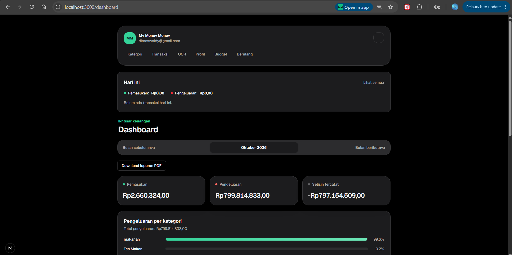
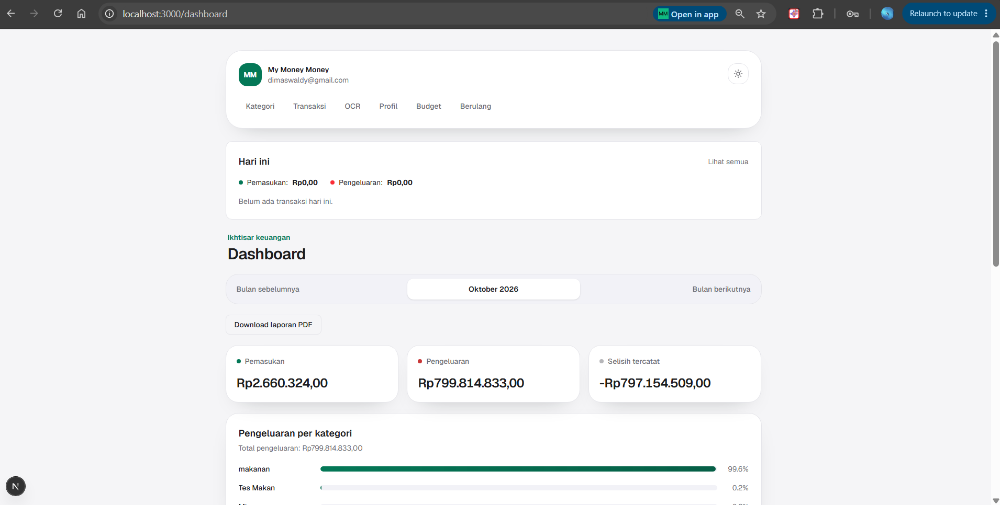
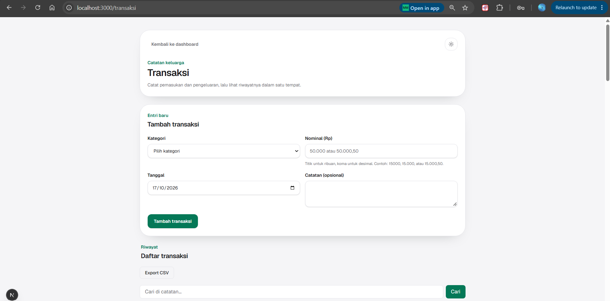
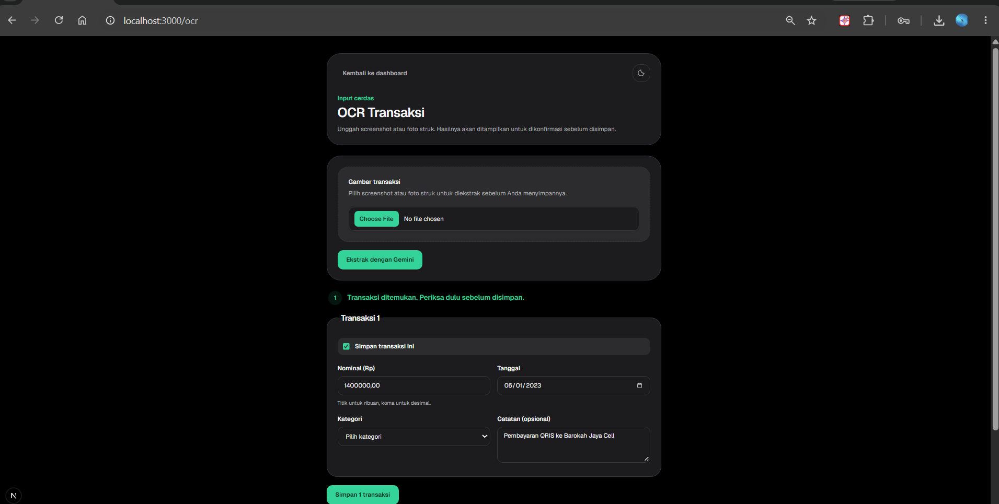
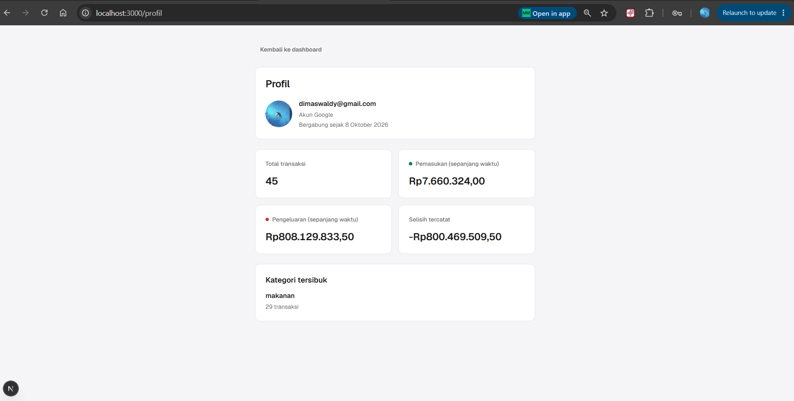
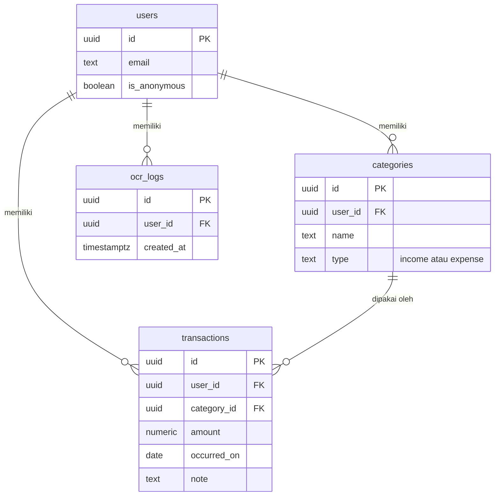

# My Money Money


> Aplikasi pencatat keuangan keluarga dengan input OCR dari screenshot struk atau nota.

**Demo live:** https://keuangan-keluarga-opal.vercel.app

> Login Google di demo dibatasi hanya untuk test user. Untuk mencoba tanpa daftar, klik tombol **"Coba Demo tanpa Login"** di halaman masuk.

## Fitur utama

- Login Google atau mode demo tanpa daftar
- Kategori pemasukan/pengeluaran (tambah, lihat, hapus)
- Transaksi dengan format Rupiah (titik ribuan, koma desimal)
- Ringkasan bulanan: pemasukan, pengeluaran, selisih
- OCR: unggah screenshot struk, Gemini mengekstrak transaksinya dengan fallback ke Groq kalau Gemini penuh, user konfirmasi dan edit sebelum simpan
- Isolasi data per akun lewat Row Level Security
- Batas OCR 10 kali per user per hari

## Stack

| Lapisan  | Teknologi                                         |
| -------- | ------------------------------------------------- |
| Frontend | Next.js 16 (App Router), TypeScript, Tailwind CSS |
| Backend  | Supabase (Postgres, Auth, Row Level Security)     |
| OCR      | Google Gemini 3.5 Flash, fallback ke Groq (Llama 3.2 Vision) |
| Hosting  | Vercel                                            |

## Screenshot

**Dashboard (mode gelap):**



**Dashboard (mode terang):**



**Daftar transaksi:**



**OCR: unggah struk, konfirmasi, simpan:**



**Profil dengan statistik:**



## Menjalankan di lokal

1. Clone repo dan `npm install`.
2. Buat project Supabase di supabase.com.
3. Salin `.env.example` ke `.env.local`, isi empat variabel:
   - `NEXT_PUBLIC_SUPABASE_URL`
   - `NEXT_PUBLIC_SUPABASE_PUBLISHABLE_KEY`
   - `GEMINI_API_KEY` (dari aistudio.google.com/apikey)
   - `GROQ_API_KEY` (dari console.groq.com, opsional sebagai fallback OCR)
4. Jalankan migrasi SQL di folder `db/` secara berurutan (001 sampai 011) di SQL Editor Supabase.
5. Aktifkan provider Google di Supabase Authentication (lihat dokumentasi Supabase).
6. `npm run dev`, buka http://localhost:3000.

## Menjalankan test

```bash
npm test
```

## Arsitektur

### Relasi database (ERD)



## Struktur proyek

```text
app/
  auth/callback/
  dashboard/
  kategori/
  login/
  ocr/
  transaksi/
  layout.tsx
  page.tsx
utils/
  supabase/
  date.ts
db/
  001_init.sql
  002_ringkasan_bulanan.sql
  003_seed_demo.sql
  004_ocr_logs.sql
  005_ocr_check_split.sql
  006_expense_by_category.sql
  007_monthly_trend.sql
  008_profile_stats.sql
  009_category_unique_case_insensitive.sql
  010_budgets.sql
  011_recurring_rules.sql
docs/
  BLUEPRINT.md
AGENTS.md
.env.example
proxy.ts
components/
  theme-provider.tsx
  theme-toggle.tsx
  expense-chart.tsx
  trend-chart.tsx
  budget-progress.tsx
  today-transactions.tsx
  service-worker-register.tsx
app/
  budget/
  profil/
  recurring/
  ...
```

## Dokumentasi tambahan

- [Blueprint proyek](docs/BLUEPRINT.md)
- [Aturan kerja](AGENTS.md)
- [Catatan keamanan](docs/SECURITY.md)
- [Hasil tes penyimpanan nominal](docs/TEST_NOMINAL.md)

## Lisensi

Belum ditentukan.
