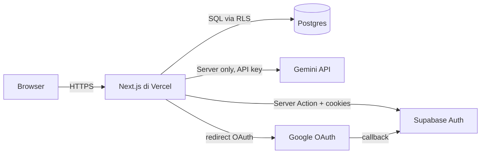
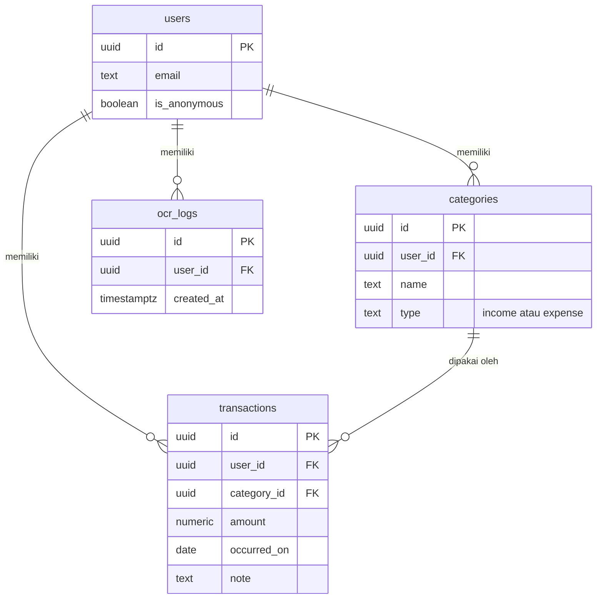

# My Money Money

> Aplikasi pencatat keuangan keluarga dengan input OCR dari screenshot struk atau nota.

**Demo live:** https://keuangan-keluarga-opal.vercel.app

> Login Google di demo dibatasi hanya untuk test user. Untuk mencoba tanpa daftar, klik tombol **"Coba Demo tanpa Login"** di halaman masuk.

## Fitur utama

- Login Google atau mode demo tanpa daftar
- Kategori pemasukan/pengeluaran (tambah, lihat, hapus)
- Transaksi dengan format Rupiah (titik ribuan, koma desimal)
- Ringkasan bulanan: pemasukan, pengeluaran, selisih
- OCR: unggah screenshot struk, Gemini mengekstrak transaksinya, user konfirmasi dan edit sebelum simpan
- Isolasi data per akun lewat Row Level Security
- Batas OCR 10 kali per user per hari

## Stack

| Lapisan  | Teknologi                                         |
| -------- | ------------------------------------------------- |
| Frontend | Next.js 16 (App Router), TypeScript, Tailwind CSS |
| Backend  | Supabase (Postgres, Auth, Row Level Security)     |
| OCR      | Google Gemini 3.5 Flash                           |
| Hosting  | Vercel                                            |

## Screenshot


## Menjalankan di lokal

1. Clone repo dan `npm install`.
2. Buat project Supabase di supabase.com.
3. Salin `.env.example` ke `.env.local`, isi tiga variabel:
   - `NEXT_PUBLIC_SUPABASE_URL`
   - `NEXT_PUBLIC_SUPABASE_PUBLISHABLE_KEY`
   - `GEMINI_API_KEY` (dari aistudio.google.com/apikey)
4. Jalankan migrasi SQL di folder `db/` secara berurutan (001 sampai 005) di SQL Editor Supabase.
5. Aktifkan provider Google di Supabase Authentication (lihat dokumentasi Supabase).
6. `npm run dev`, buka http://localhost:3000.

## Keputusan arsitektur dan keamanan

- Semua Server Action memanggil `supabase.auth.getUser()` sendiri dan tidak mempercayai frontend.
- Row Level Security aktif di setiap tabel. User hanya bisa mengakses baris miliknya sendiri.
- Foreign key gabungan `(category_id, user_id)` di tabel `transactions` mencegah pemalsuan `category_id` antar user.
- Nominal uang disimpan sebagai `numeric(14,2)`, bukan float, dan dikirim sebagai string desimal untuk menghindari galat pembulatan.
- Tanggal dihitung dengan zona `Asia/Jakarta`, tidak bergantung pada default UTC database.
- OCR hanya tersedia untuk user login. Mode demo ditolak, dan screenshot tidak disimpan setelah diproses.
- Ringkasan bulanan dihitung lewat fungsi SQL, bukan di aplikasi, karena API membatasi jumlah baris per permintaan.

## Arsitektur

Aplikasi berjalan sepenuhnya di server. Browser hanya menerima HTML dan cookie sesi. Setiap permintaan data melewati Server Action Next.js yang memvalidasi sesi lewat Supabase, lalu query ke Postgres dengan Row Level Security aktif. API key Gemini tidak pernah sampai ke browser.

### Alur aplikasi



### Relasi database (ERD)



## Struktur proyek

```text
app/
  auth/callback/
  dashboard/
  kategori/
  login/
  ocr/
  transaksi/
  layout.tsx
  page.tsx
utils/
  supabase/
  date.ts
db/
  001_init.sql
  002_ringkasan_bulanan.sql
  003_seed_demo.sql
  004_ocr_logs.sql
  005_ocr_check_split.sql
docs/
  BLUEPRINT.md
AGENTS.md
.env.example
proxy.ts
```

## Dokumentasi tambahan

- [Blueprint proyek](docs/BLUEPRINT.md)
- [Aturan kerja](AGENTS.md)
- [Catatan keamanan](docs/SECURITY.md)
- [Hasil tes penyimpanan nominal](docs/TEST_NOMINAL.md)

## Lisensi

Belum ditentukan.
